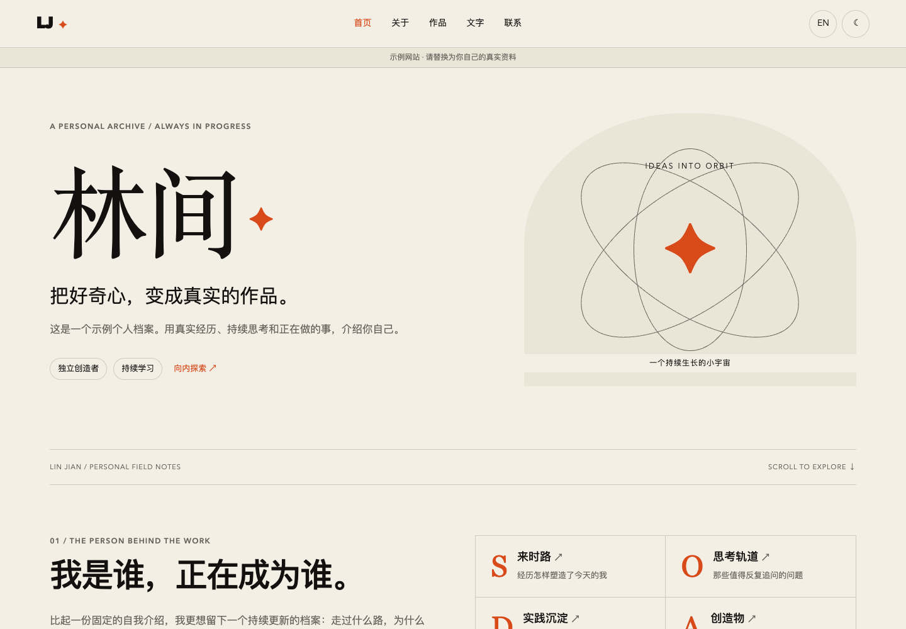
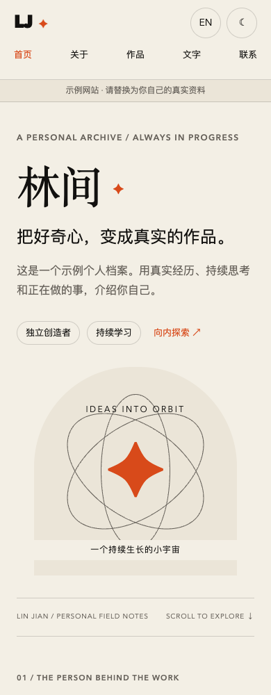

# SODA 个人建站 Skill

用你的真实经历、思考、方法和作品，搭建一个持续更新的个人网站。

从 [苏打的个人网站](https://www.sodasai.com/) 提炼，保留暖米色纸面、黑色大标题、橙色点缀与 S / O / D / A 四个档案房间。你提供个人资料，AI 使用这个 Skill 生成可以独立运行的网站。

## 默认长什么样

以下是模板的真实截图。“林间”是示例人物，使用时会换成你的内容。没有照片时显示抽象轨道图；你也可以换成自己的肖像。



<details>
<summary>查看手机首屏</summary>



</details>

首页顺序为：个人首屏 → 关于我与档案入口 → 作品 → 文章 → 联系。四个房间分别记录经历、观点、实践方法和创造物，可以改名或隐藏。

## 安装

在你准备建站的工作目录运行：

```bash
npx skills add sucrush912-commits/soda-personal-site --agent codex --yes
```

这是项目级安装，不修改全局配置。使用其他支持 Agent Skills 的工具时，可以运行 `npx skills add sucrush912-commits/soda-personal-site`，按安装器提示选择客户端。

## 使用

安装后，对 AI 说：

> 用 $soda-personal-site 帮我搭建个人网站。我叫……，希望让……认识我。我能公开的经历、作品和文章是……。先在本地生成并验证。

也可以把本仓库链接交给能读取 GitHub、操作本地文件的 AI，让它读取 [SKILL.md](SKILL.md) 和附带模板后开始。仅支持聊天、不能写文件或运行命令的客户端只能提供方案。

默认保留截图中的设计方向。你可以要求换配色、字体、房间名称或布局。AI 应使用你愿意公开的真实资料，材料不足时保留空状态；不会替你编造履历、客户评价或成绩。

## 包含什么

- 可直接读取的 [SKILL.md](SKILL.md)，以及设计、内容和验收参考。
- 可独立运行的 Next.js / React / TypeScript 起步模板。
- 集中在 `site.config.json` 的个人资料、作品、文章和联系方式。
- 中英文切换、持久明暗主题、作品档案、文章筛选、阅读弹窗与文章独立链接。
- 安全生成器：拒绝覆盖已有目录、拒绝危险链接；示例默认禁止索引。

## 也可以直接体验模板

克隆或下载本仓库后，在仓库目录运行：

```bash
node scripts/create-site.mjs --output ../my-personal-site
cd ../my-personal-site
npm ci
npm run dev
```

生成站点的根目录有独立 README。编辑 `site.config.json` 即可换成自己的内容；自己的图片放到生成站点的 `public/images/`。网站生成后可以脱离本 Skill 和原作者仓库继续维护。

## 环境与发布

需要支持 Agent Skills 的客户端，以及 Node.js 20.9 以上。生成器只使用 Node 内置模块。模板没有 AI API、数据库、登录或必须购买的服务；托管和域名由你自己选择，按实际平台计费。

正式发布前替换示例内容、填写自己的域名，完成构建与手机检查。Skill 不会自动购买域名、接入收费服务或把网站发布出去。双语按钮用于阅读偏好，默认没有独立的语言 URL。

## 验证

生成器 5 项测试通过；起步模板通过 lint、类型检查、生产构建和 72 项浏览器检查，覆盖桌面/手机视口、中英文、明暗主题、路由和文章阅读。公开后的远程安装会在隔离目录中核对资源；验证不代替使用者对自己内容和发布环境的验收。

维护者可运行：

```bash
node --test scripts/create-site.test.mjs
```

模板构建检查见 [模板 README](assets/starter/README.md)。

## 使用范围与维护

本仓库的 Skill 和起步代码供任何人参考、修改，用于搭建自己的个人网站。原站人物身份、照片、文章、联系方式、二维码、项目图片和音乐不随本仓库提供；第三方依赖遵循各自许可证。

后续 Skill 更新以本公开仓库为唯一维护源。网站生成后由使用者维护自己的内容和依赖，不会自动跟随原作者网站更新。
